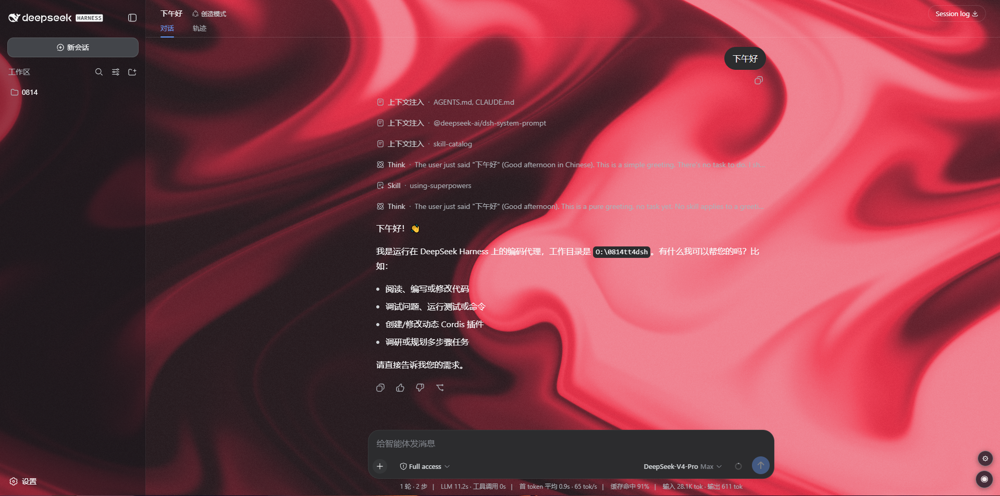
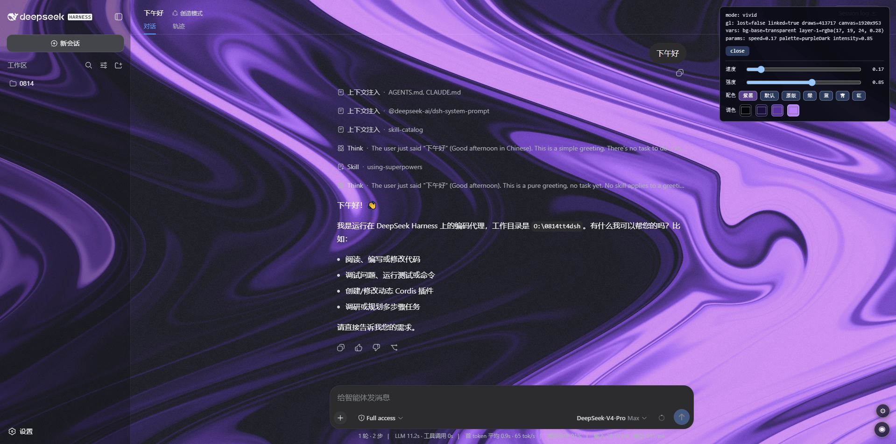

# 🧵 silk-background

**dsh Web GUI 客户端插件**：WebGL "Silk" 丝绸着色器动态背景 + 全站玻璃化皮肤。

基于官方 web-profile 插件机制（`dsh.client` 声明 + bundle patch 层）实现，
不修改 dsh 任何源码或前端产物，卸载即还原。

同一份插件同时适用于 **`dsh web`** 和 **DeepSeek Harness 桌面版（GUI）**：
桌面版的 Electron 主进程用 `desktop` profile 拉起的是同一个 web shell，
渲染进程的平台标识仍是 `web`，`theme.overrideTokens` 等接口也与 web profile
完全一致。所以"移植到桌面端"不需要改代码，只需要把包装进对应的 profile
（见下文「桌面端（GUI）安装」一节）。

<div align="center">

[](https://github.com/topics/dsh-plugin)
[](./package.json)
[](./LICENSE)
[]()
[]()

</div>

---

## 🖼️ 预览

<div align="center">
  <table>
    <tr>
      <td></td>
      <td></td>
    </tr>
  </table>
</div>

## ✨ 特性

**视觉**
- 🎨 WebGL Silk 着色器（21st.dev Shader Builder）：全屏动态丝绸纹理，指针跟随/扭曲
- 🖥️ 自适应分辨率与 2M 像素预算，页面不可见时自动停渲染（省电）
- 🌗 三模式：`off` / `dim`（默认，可读性优先玻璃）/ `vivid`（高亮丝绸）

**主题**
- 🧊 全站玻璃化：通过 dsh 官方 theme 服务的 `overrideTokens` 注册 alias token 覆盖层
  （`--dsw-alias-bg-base`、`--dsw-alias-bg-layer-1/2`、`--dsw-specific-sidebar-fill`，亮/暗两套值）
- 🔄 主题重同步与亮暗切换自动保持，无需逐元素 DOM 手术（v4）

**控制**
- 🔘 右下角圆形按钮一键循环切换模式，选择持久化在 `localStorage`
- ⚙️ 独立设置面板：速度/强度滑杆、7 套配色、4 色 RGB 取色板，全部持久化

**健壮性**
- ♿ `prefers-reduced-motion` 适配
- 🛡️ WebGL 上下文丢失/恢复、主题重同步自愈

**兼容**
- 💻 `dsh web` 与桌面版（GUI）共用同一份客户端插件，装进对应 profile 即可，
  代码里没有任何平台分支

**调试**
- 🐞 URL 加 `?silk-debug` 打开状态面板；控制台可用 `window.__dshSilk`
  （`mode` / `engineStatus` / `setMode(m)`）

## 📦 依赖

插件本体**零运行时依赖**（纯浏览器 JS + WebGL，无需构建步骤）。

| 工具 | 用途 | 说明 |
|---|---|---|
| `dsh` | 宿主 | 任意支持 web profile 的版本：`dsh web`，或桌面版（`desktop` profile） |
| `pnpm` | 安装器 | `dsh plugin` 内部把参数转发给 profile 目录下的 pnpm |
| `git` | 拉取源码 | 仅 `github:` / `git+` 安装方式需要 |

## 🚀 安装（git 方式，推荐）

```bash
# 从 GitHub 仓库安装（dsh plugin 会自动把本包加入 profile 的 bundle 层）
dsh plugin --profile web add github:z21for99/silk-background

# 或锁定到某个 tag/commit
dsh plugin --profile web add "git+https://github.com/z21for99/silk-background.git#v0.4.0"

# 重启 web 让新 profile 生效（端口按需改）
dsh web --port 17890
```

Windows 上可运行本仓库附带的 `restart-web.ps1`：它只会结束命令行里带
`dsh` + `web --port` 的 node 进程并重新拉起 17890 端口，其它 node 进程不受影响。

> 💡 本仓库**没有** `prepare` 构建脚本，pnpm 安装 git 依赖时无需
> `allowBuilds` 配置；若你 fork 后加了构建脚本，需按 pnpm 提示在
> profile 的 `pnpm-workspace.yaml` 里放行。

## 🧩 安装（手动方式，离线 / 兜底）

1. 把本包整目录复制到
   `$DSH_HOME/profiles/web/node_modules/silk-background`
   （Windows：`%USERPROFILE%\.dsh\profiles\web\node_modules\silk-background`）
2. 打开 `$DSH_HOME/profiles/web/cordis.patch.yml`，加入本仓库
   `cordis.patch.yml` 中的 `- insert:` 块
3. 重启 `dsh web`

## 🖥️ 桌面端（GUI）安装

桌面版和 `dsh web` 跑的是**同一个 Web 壳**：Electron 主进程用
`dsh-desktop-host` 在本地起一个 webServer，再用 `desktop` profile 拉起同一套
前端。所以本插件不需要任何移植改动，只是要装进 `desktop` profile，而不是
`web` profile。

> 已在 Windows 桌面版实测：补丁保存后 1~2 秒背景就出现，**不需要重启 App**。
> 原因是 `dsh-hmr` 会热重载 profile 配置，`dsh-client-hmr` 再把新的模块行推给
> 已打开的页面（`entries.sync`）。

**1. 把包拷进 `desktop` profile**

```powershell
$dst = "$env:USERPROFILE\.dsh\profiles\desktop\node_modules\silk-background"
New-Item -ItemType Directory -Force $dst | Out-Null
# 在本仓库根目录执行；screenshots 可以不拷
Copy-Item .\client.js, .\package.json, .\cordis.patch.yml, .\LICENSE, .\README.md $dst
Copy-Item .\lib $dst -Recurse
```

**2. 在 `desktop` profile 的补丁里登记一行**

编辑 `%USERPROFILE%\.dsh\profiles\desktop\cordis.patch.yml`，在末尾追加：

```yaml
- insert:
    - id: silk-background
      name: 'silk-background'
      config:
        enabled: true
```

**3. 让它生效**

保存即生效，通常 1~2 秒后右下角就会出现 `◐` 按钮、页面变成玻璃 + 丝绸。
没有反应就重启 App 一次（正式版没有「重新加载页面」菜单项，开发版才有）。
调试可以按 `F12` 打开开发者工具，控制台里看 `window.__dshSilk`。

> 若本机 PATH 里有 `dsh` CLI，也可以走和 web 端相同的命令，把 `--profile web`
> 换成 `--profile desktop`：`dsh plugin --profile desktop add github:z21for99/silk-background`。
> 手动拷贝的好处是不需要 pnpm、不需要联网。

**卸载**：删掉上面那段 `- insert:` 块，再删掉
`node_modules\silk-background` 目录；同样 1~2 秒内还原，没生效就重启 App。

## 🎛️ 使用

- 右下角按钮：`✕`(off) → `◐`(dim) → `◉`(vivid) 循环
- 按钮上方的 ⚙：速度 / 强度 / 配色 / RGB 取色
- 调参只影响本机浏览器（`localStorage`），换浏览器/清缓存即恢复默认
- 亮色主题（Settings → Appearance → Light）下会使用对应的浅色玻璃值；
  丝绸预设本身偏暗色系，亮色下观感更淡，可自行用 RGB 取色板调亮
- web 端和桌面端是**两个不同的 origin**，`localStorage` 不互通：模式 / 速度 /
  强度 / 配色要两边各自调一次（清缓存也会回到默认）
- 已知观感问题：桌面壳底部比 web 端多一条状态栏（步数 / token 统计），右下角
  两个圆钮会压在它上面；功能不受影响

## 🗑️ 卸载

```bash
dsh plugin --profile web remove silk-background
# 重启 dsh web
```

桌面端如果是手动安装的：删掉 `profiles\desktop\cordis.patch.yml` 里那段
`- insert:` 块，再删除 `profiles\desktop\node_modules\silk-background` 目录。

## 🔄 从旧的手工安装迁移

如果你之前是「复制包 + 手改 `cordis.patch.yml`」装的（本插件 0.2.x 时代的
方式），升级到 git 安装：

1. 编辑 `$DSH_HOME/profiles/web/cordis.patch.yml`，**删除** silk-background
   的 `- insert:` 块（否则同一 id 会被两个补丁层插入）
2. 执行上面的 `dsh plugin --profile web add ...`
3. 重启 `dsh web`；旧的手工 `node_modules/silk-background` 会被 pnpm
   的 git 安装版本覆盖

## ⚙️ 原理速览

```
dsh plugin add → pnpm 安装本包 → dsh.bundle.patch 声明使本包自动进入
profile 的 bundle 层 → 本包的 cordis.patch.yml 插入 loader 入口行 →
dsh-client-modules 扫描到 dsh.client 声明 → 打包进 window.__DSH_BOOT__
引导清单 → /plugins/silk-background/client.js 由模块加载器在浏览器内核
物化 → apply(ctx) 挂载 WebGL 画布（z-index:-1），并经
theme.overrideTokens 注册玻璃化 token 层（v4）
```

web 端与桌面端走的是同一条链路，差别只在 profile 目录
（`profiles/web` vs `profiles/desktop`），浏览器半边是完全相同的产物。

## 🤝 反馈与贡献

- 使用问题 / 建议：开 [Issue](../../issues)
- 想一起改进：欢迎 PR，较大改动前建议先开 Issue 讨论
- 更多 DSH 插件：[github.com/topics/dsh-plugin](https://github.com/topics/dsh-plugin)

## 📄 许可证

[MIT](./LICENSE) © 2026 z21for99。

WebGL "Silk" 着色器来自 21st.dev Shader Builder，其使用条款以 21st.dev 为准。

## ❓ 常见问题

- **看不到背景**：地址栏加 `?silk-debug` 看面板里的 `gl`/`vars` 行；
  控制台 `window.__dshSilk.engineStatus`；确认浏览器支持 WebGL
- **桌面端装了没反应**：确认包在
  `%USERPROFILE%\.dsh\profiles\desktop\node_modules\silk-background`、补丁写在
  `profiles\desktop\cordis.patch.yml`（不是 `profiles\web`）；保存补丁后等 1~2 秒，
  还不行就重启 App；按 `F12` 在开发者工具控制台里看 `window.__dshSilk`
- **点击按钮无反应**：确认安装后重启过 `dsh web`（引导清单在启动时生成），
  并硬刷新浏览器（Ctrl+F5）
- **页面变全透明**：`dim`/`vivid` 模式下 `--dsw-alias-bg-base` 被设为
  `transparent`，这是设计使然；不喜欢玻璃感就切到 `off`
